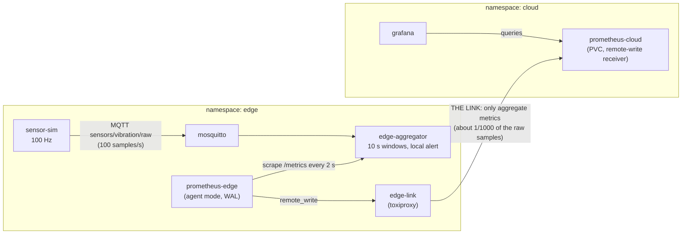

# Hybrid edge/cloud demo, running locally

A seminar demo for "Architecture and implementation of hybrid systems: combining cloud and edge computing". It runs a small edge site and a small cloud site as two Kubernetes namespaces in one local k3d cluster. A simulated vibration sensor produces 100 samples per second. An edge aggregator reduces them to one summary per 10 seconds and raises alerts on its own. Only the summaries cross a deliberately breakable "WAN link" to a cloud Prometheus and Grafana. The demo scripts show three things: data reduction at the edge, alerts that do not depend on the cloud, and store-and-forward that fills the gap after a cloud outage.

## Architecture



What crosses the link: only the Prometheus metrics of the aggregator (window statistics, counters, alert state), sent by `remote_write`. The raw 100 Hz samples never leave the edge. Alerts are decided at the edge. If the link or the cloud is down, the agent buffers in its WAL and replays when the link returns.

## Prerequisites

- docker (daemon running), kubectl, make, python3, curl
- k3d is installed automatically by `demo/00-setup.sh` into `~/.local/bin` if it is missing
- free host ports: 3000, 9090, 8000, 8080, 8474
- internet access on first run, to pull images

## Quickstart (about 10 minutes)

```bash
./demo/00-setup.sh
```

This checks the tools and ports, creates the k3d cluster `edge-cloud`, builds and imports the two local images, deploys everything and waits until it is ready. Then open http://localhost:3000 (anonymous viewer access works; or log in as `admin` / `admin`). The dashboard is "Edge -> Cloud Demo". Panels: raw vs aggregate rate, data reduction ratio, window mean with min/max band, window RMS, alert state, anomalies, link health.

Grafana can be empty for about the first minute while data arrives. `demo/status.sh` (or `make status`) shows the state of the stack.

## Demo script

Run these from the repository root with the stack up. Each script prints PASS or FAIL at the end. The numbers below are examples from single runs on one machine. They vary from run to run and are not guarantees.

To watch values stream in a terminal while a scenario runs, use the live watchers in `watch/` (`make watch-all` opens all four in tmux). See `SEMINARY_INSTRUCTION.md`, section 5.

### 1. Data reduction: `./demo/01-data-reduction.sh`

Shows that the cloud receives about one aggregate per 10 s instead of about 100 raw samples per second.
In Grafana: "Raw samples vs aggregates" and "Data reduction ratio".
Observed: raw rate about 95-100 samples/s measured directly (99.8/s on the aggregator). Reduction ratio observed 934, 1134 and 967 on a warmed-up stack (raw 99.6/s, aggregate 0.103/s); about 1000 is expected for 100 Hz and a 10 s window. Measured right after startup the numbers are distorted by `rate()` (raw 27.8/s and ratio 1489 in one run, 60.9/s in another), so run this script after the stack has been up for a couple of minutes. The script passes if the ratio is above 100.

### 2. Local alert: `./demo/02-local-alert.sh`

Injects a vibration burst (8 s, amplitude 8). The edge aggregator decides on a rolling 1 s RMS, with no cloud involved. The cloud sees the same alert only after scrape, remote_write and query delay.
In Grafana: "Alert state" and "Window RMS".
Observed: edge alert after 107 ms, cloud after 611 ms (earlier run: 163 ms / 1674 ms). The script passes if the edge delay is under 1000 ms and the cloud sees the alert.

### 3. Cloud outage and backfill: `./demo/03-outage-backfill.sh`

Scales `prometheus-cloud` to 0 for 60 s, brings it back, waits 30 s for the agent to flush, then checks the cloud for gaps (2 s steps with `count_over_time`). It also prints the agent's remote_write counters.
In Grafana: the data may look missing or flat during the outage. Refresh the dashboard after recovery and the gap is filled.
Observed: 61 two-second steps checked, 0 gaps in the outage window; the agent retried 9500 samples and failed 0. The script also reported 7 gaps 18-30 s before the outage window, from stack startup; they are outside the checked window.
Do not restart the `prometheus-edge` pod during or around this scenario (see limitations).

### 4. Latency (optional): `./demo/04-latency.sh`

Adds +2000 ms latency to the link (Toxiproxy, upstream direction), repeats the alert measurement, then removes the toxic when it exits.
In Grafana: the cloud-side alert lags; the edge decision is unaffected.
Observed: edge alert after 107 ms, cloud after 4629 ms (earlier run: 110 ms / 4642 ms).

### 5 and 6. Cut and restore the link: `./demo/05-link-down.sh`, `./demo/06-link-up.sh`

Manual version of the outage, for live narration. `05` disables the Toxiproxy proxy, so remote_write connections fail. The edge keeps working (check http://localhost:8000/metrics) while cloud series stop. `06` re-enables it and the agent replays its buffer.
In Grafana: cloud series flatline after `05`; after `06` wait about 10 s and refresh, and the gap fills in.
Expected output: `PASS link is DOWN (enabled=False)` and `PASS link is UP (enabled=True)`.

## Contract summary

Full details are in [CONTRACT.md](CONTRACT.md) (frozen).

- MQTT: `sensors/vibration/raw` (QoS 0, JSON `{"ts", "value"}`), `sensors/vibration/control` (JSON `{"cmd":"burst","duration_s","amplitude"}`). `POST :8080/burst?duration_s=5&amplitude=8` publishes the control message.
- Metrics (label `sensor="vibration"`): `edge_window_mean`, `_min`, `_max`, `_std`, `_rms`, `edge_anomaly_count`, `edge_anomalies_total`, `edge_alert_active`, `edge_alert_last_change_timestamp_seconds`, `edge_raw_samples_total`, `edge_aggregates_emitted_total`. The agent adds `site="edge-1"`.
- sensor-sim env: `MQTT_HOST`, `MQTT_PORT`, `SAMPLE_RATE_HZ=100`, `SIGNAL_FREQ_HZ`, `SIGNAL_AMPLITUDE`, `NOISE_STD`, `ANOMALY_RATE`, `ANOMALY_AMPLITUDE`, `HTTP_PORT=8080`.
- edge-aggregator env: `MQTT_HOST`, `MQTT_PORT`, `WINDOW_SECONDS=10`, `ANOMALY_THRESHOLD=3.0`, `ALERT_RMS_THRESHOLD=1.5`, `ALERT_WINDOW_SECONDS=1`, `METRICS_PORT=8000`.
- Host ports: 3000 Grafana, 9090 cloud Prometheus, 8000 aggregator metrics, 8080 sensor-sim control, 8474 Toxiproxy API.
- Images are pinned: prom/prometheus v3.5.0, grafana 11.5.2, toxiproxy 2.9.0, mosquitto 2.0.20.

Backfill evidence: [docs/backfill-findings.md](docs/backfill-findings.md).

## Tests

```bash
./demo/run-tests.sh
```

Runs the edge-aggregator unit tests inside `python:3.11-slim` (host Python may be 3.10). Observed: 10 passed.

## Teardown

```bash
./demo/99-teardown.sh
```

Deletes the k3d cluster and the two local images.

## Troubleshooting

- **Port busy:** `00-setup.sh` lists busy ports among 3000, 9090, 8000, 8080, 8474. Stop whatever uses them and rerun.
- **ImagePullBackOff:** the local images are not in the cluster. Run `make build` (builds and runs `k3d image import`), then check pods with `kubectl --context k3d-edge-cloud get pods -A`. For public images, check your internet connection and that Docker can pull them.
- **WSL2:** if `localhost:3000` does not open from Windows, try the WSL IP, or check that localhost forwarding is enabled in your WSL setup.
- **Grafana empty:** wait about a minute after start; data takes a while to arrive.
- **Grafana still shows a gap after an outage:** refresh the dashboard.
- **kubectl:** always use the context, for example `kubectl --context k3d-edge-cloud -n edge get pods`. `make logs` shows aggregator logs.

## Known limitations

- Restarting the `prometheus-edge` pod during an outage LOSES the unsent data (a spike finding). Never do it in the demo.
- Outages up to 10 minutes were backfilled in the Docker spike, but only the 60 s scenario was run on k3d.
- Outages over 4 h and the WAL retention defaults were not tested.
- The cloud needs its PVC to keep pre-outage history across scale-to-0. Without it history is lost, though the outage window itself is still backfilled.
- The out-of-order window (`1h`) is a safety net, not what makes backfill work.
- Prometheus v3 uses `--agent`; the old `--enable-feature=agent` spelling no longer exists.
- Only the single-cluster variant exists; a two-cluster variant was not built.
- The latency toxic is added on the upstream direction.
- Grafana shows the gap-free data only after a refresh.
- The timing numbers above come from single runs on one machine.
